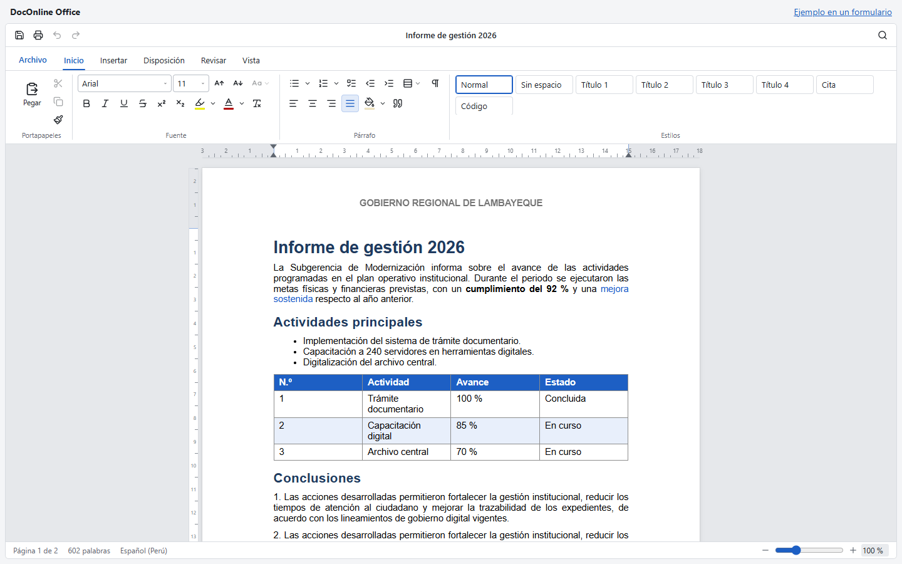
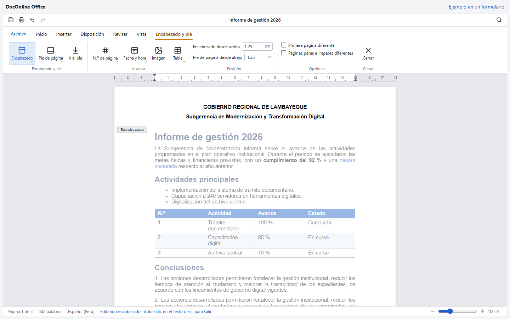
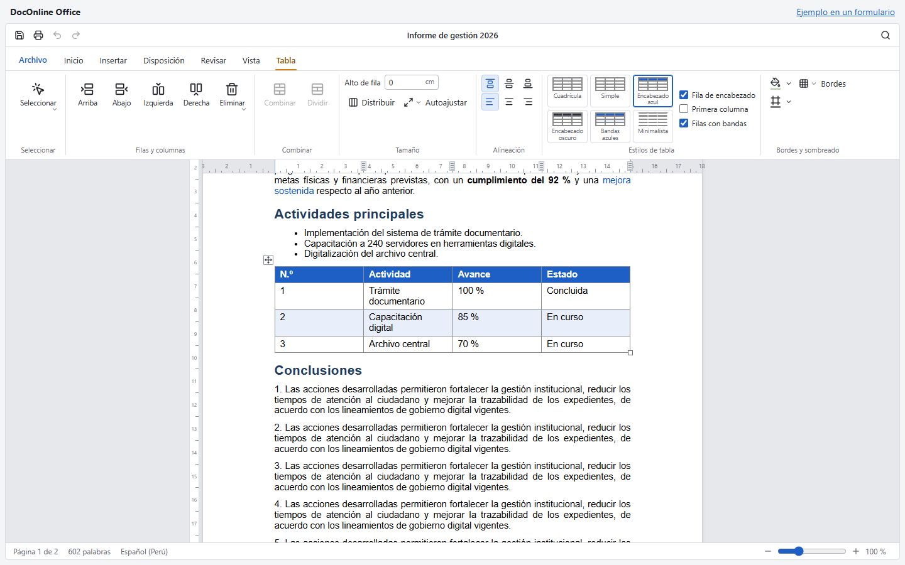
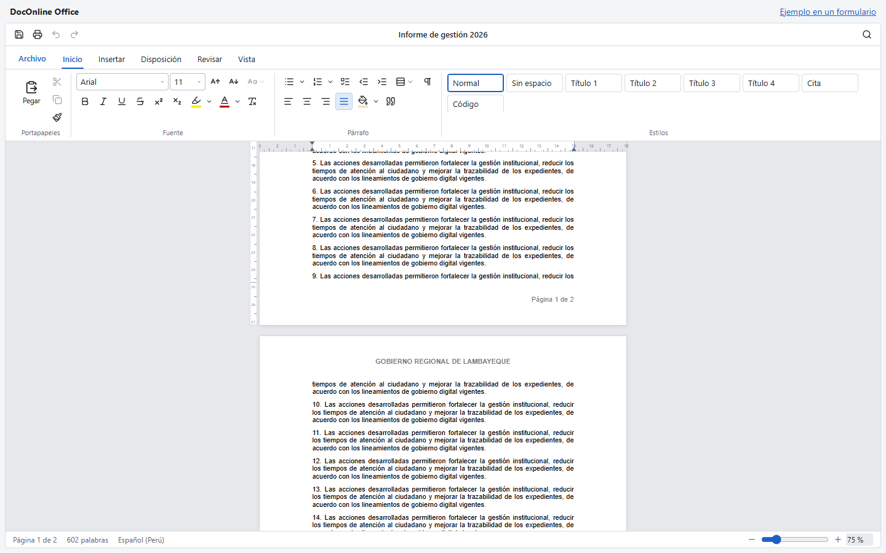
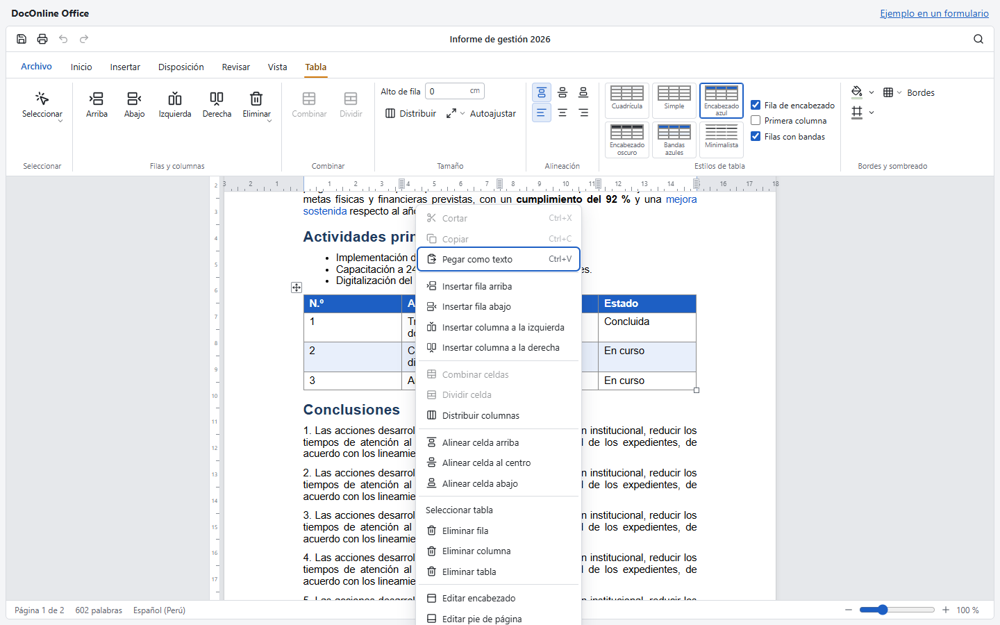
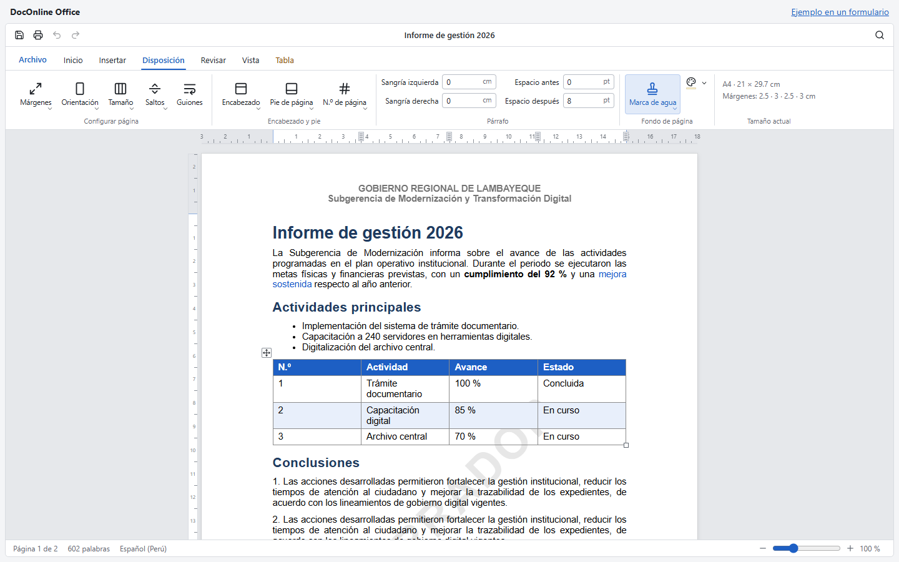
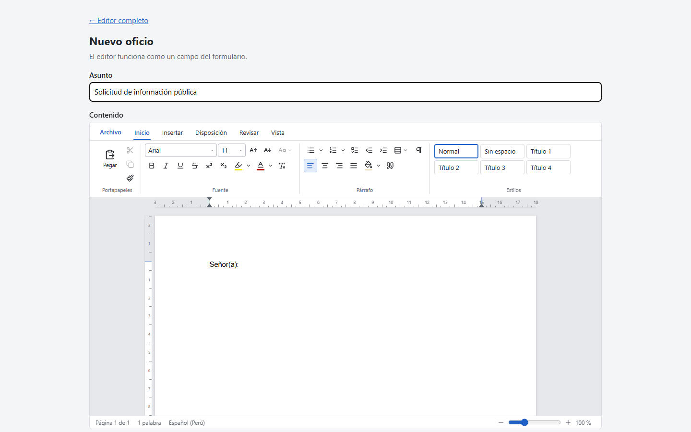

# DocOnline Office

Editor de documentos **tipo Word** para React y Next.js: hojas reales, encabezado y pie de
página, tablas, regla interactiva, exportación a **.docx** e impresión a **PDF**.

Corre 100 % en el navegador. No necesita servidor de documentos ni licencias de pago. Todas las
dependencias son libres y se pueden usar en proyectos comerciales.



---

## Contenido

- [Capturas](#capturas)
- [Características](#características)
- [Probarlo en 1 minuto](#probarlo-en-1-minuto)
- [Cómo implementarlo en tu proyecto](#cómo-implementarlo-en-tu-proyecto)
- [Guardar y abrir documentos](#guardar-y-abrir-documentos)
- [Referencia del componente](#referencia-del-componente)
- [Ejemplos](#ejemplos)
- [Estructura del proyecto](#estructura-del-proyecto)
- [Límites conocidos](#límites-conocidos)
- [Dependencias y licencias](#dependencias-y-licencias)

---

## Capturas

| Encabezado y pie (doble clic en el margen) | Tablas con estilos, asas y regla de columnas |
|---|---|
|  |  |

| Paginación real (el texto pasa de hoja en hoja) | Menú contextual de tablas |
|---|---|
|  |  |

| Disposición: sangrías, espaciado y marca de agua | Dentro de un formulario |
|---|---|
|  |  |

---

## Características

**La hoja, como en Word**
- **Paginación real.** Hojas separadas; el texto que no cabe pasa a la siguiente línea por línea
  mientras escribes. Las tablas se cortan entre filas y un título nunca queda solo al final de
  una hoja.
- **Regla horizontal interactiva:** arrastra los márgenes y las sangrías (primera línea, izquierda
  y derecha). Con el cursor en una tabla, también los bordes de columna.
- **Regla vertical** para los márgenes superior e inferior.
- Flechas ↑ y ↓ entre hojas, clic en el margen para ubicar el cursor, y Ctrl + rueda para el zoom.

**Encabezado y pie de página**
- **Doble clic** en el margen superior o inferior abre su edición. El texto del documento se
  atenúa y se abre la pestaña *Encabezado y pie*.
- Contenido con formato: negrita, alineación, colores, logo (imagen), tablas sin bordes para
  maquetar, y fecha y hora.
- **Número de página** arriba o abajo, «Página X de Y», o en la posición del cursor.
- Primera página diferente, páginas pares e impares diferentes, y distancia al borde.

**Tablas**
- Cuadrícula o tabla personalizada (filas, columnas y fila de encabezado).
- **⊞** selecciona toda la tabla y la esquina cambia su ancho arrastrando.
- **Pestaña Tabla:**
  - seleccionar celda, fila, columna o tabla;
  - insertar y eliminar filas y columnas, combinar y dividir celdas;
  - alto de fila, distribuir columnas y autoajustar;
  - alineación de celda y de tabla;
  - 6 estilos, fila de encabezado, primera columna y filas con bandas;
  - sombreado de celda, tipos de borde y color de borde.
- **Clic derecho** abre un menú con las acciones de tabla. Mayús + clic derecho abre el menú del
  navegador, con la ortografía.

**Cinta de opciones**
- **Archivo:** nuevo, abrir (.docx, .html, .txt), guardar, descargar .docx o HTML, e imprimir o
  guardar como PDF.
- **Inicio:**
  - fuente, tamaño, MAYÚSCULAS/minúsculas, negrita, cursiva, subrayado, tachado, índices,
    resaltado, color y borrar formato;
  - viñetas, numeración (1, a, A, i, I) y listas de tareas;
  - sangría, interlineado, alineación, sombreado y copiar formato;
  - galería de estilos.
- **Insertar:** tabla, imagen (archivo, URL, pegar o arrastrar), vínculo, línea, salto de página,
  encabezado, pie, número de página, fecha y hora, código y símbolos.
- **Disposición:**
  - márgenes, orientación, tamaño (A4, Carta, Oficio, A5), saltos y guiones automáticos;
  - sangrías y espaciado del párrafo;
  - marca de agua y color de página.
- **Revisar:** buscar y reemplazar, ortografía del navegador y conteo de palabras.
- **Vista:** modo lectura, pantalla completa, regla, marcas ¶ y zoom.

**Salida**
- **.docx** nativo, que conserva:
  - encabezados y pies, con primera página y pares distintas;
  - los campos de número de página;
  - tablas con anchos de columna, sombreado y bordes;
  - imágenes, listas, estilos, sangrías y espaciado.
- **Imprimir o PDF:** imprime exactamente las hojas que ves en pantalla.

**Atajos:** Ctrl+B/I/U, Ctrl+Z/Y, Ctrl+S (guardar), Ctrl+P (imprimir), Ctrl+F/H (buscar y
reemplazar), Ctrl+O (abrir), Ctrl+Enter (salto de página), Tab/Mayús+Tab y Esc.

---

## Probarlo en 1 minuto

Requisitos: **Node.js 20 o superior**.

```bash
git clone https://github.com/leonxn/DocOnline-Office.git
cd DocOnline-Office
npm install
npm run dev
```

- `http://localhost:3005`: editor a pantalla completa (el borrador se guarda en el navegador).
- `http://localhost:3005/formulario`: el editor como un campo de formulario.

---

## Cómo implementarlo en tu proyecto

### 1. Copia el componente

Copia la carpeta [`components/word-editor/`](components/word-editor) a tu proyecto, por ejemplo
a `src/components/word-editor/`. Es autocontenida: trae sus estilos y no depende del resto de
este repositorio.

### 2. Instala las dependencias

```bash
npm i @tiptap/react@^3.32 @tiptap/pm@^3.32 @tiptap/starter-kit@^3.32 @tiptap/extension-text-style@^3.32 @tiptap/extension-table@^3.32 @tiptap/extension-image@^3.32 @tiptap/extension-text-align@^3.32 @tiptap/extension-highlight@^3.32 @tiptap/extension-subscript@^3.32 @tiptap/extension-superscript@^3.32 @tiptap/extension-list@^3.32 @tiptap/extensions@^3.32 docx@^9.11 mammoth@^1.13 lucide-react
```

Requiere **React 18 o 19**.

### 3. Úsalo

**Next.js (App Router).** El editor es un componente de cliente:

```tsx
// app/documentos/nuevo/page.tsx
'use client';

import { WordEditor } from '@/components/word-editor';

export default function NuevoDocumento() {
  return (
    <div style={{ height: '100vh' }}>
      <WordEditor
        initialValue="<h1>Título</h1><p>Contenido…</p>"
        onSave={async (doc) => {
          await fetch('/api/documentos', { method: 'POST', body: JSON.stringify(doc) });
        }}
      />
    </div>
  );
}
```

> Si tu proyecto no usa el alias `@/`, importa con una ruta relativa
> (`../components/word-editor`).

**React con Vite (u otro bundler).** Funciona igual: importa `WordEditor` y dale una altura a su
contenedor. Las líneas `'use client'` se ignoran fuera de Next.js.

```tsx
import { WordEditor } from './components/word-editor';

export function App() {
  return (
    <div style={{ height: '100vh' }}>
      <WordEditor />
    </div>
  );
}
```

### 4. Dentro de un formulario

Usa una `ref` para leer el documento al enviar:

```tsx
'use client';
import { useRef } from 'react';
import { WordEditor, type WordEditorHandle } from '@/components/word-editor';

export function Formulario() {
  const ref = useRef<WordEditorHandle>(null);

  async function enviar() {
    const doc = ref.current!.getDocument();       // { title, json, html, settings }
    const docx = await ref.current!.exportDocx(); // Blob .docx

    const body = new FormData();
    body.append('documento', JSON.stringify(doc));
    body.append('archivo', docx, `${doc.title}.docx`);
    await fetch('/api/oficios', { method: 'POST', body });
  }

  return (
    <>
      <WordEditor ref={ref} height={650} hideTitleBar />
      <button onClick={enviar}>Enviar</button>
    </>
  );
}
```

### 5. Encabezado y número de página por defecto

`initialValue.settings` acepta solo lo que quieras cambiar. Lo demás toma valores por defecto.

```tsx
<WordEditor
  initialValue={{
    html: '<p>Señor(a):</p>',
    settings: {
      margins: { top: 2.5, right: 2.5, bottom: 2.5, left: 3 },
      header: {
        type: 'doc',
        content: [{
          type: 'paragraph',
          attrs: { textAlign: 'center' },
          content: [{ type: 'text', text: 'MI INSTITUCIÓN', marks: [{ type: 'bold' }] }],
        }],
      },
      footer: {
        type: 'doc',
        content: [{
          type: 'paragraph',
          attrs: { textAlign: 'right' },
          content: [
            { type: 'text', text: 'Página ' }, { type: 'pageNumber' },
            { type: 'text', text: ' de ' }, { type: 'pageCount' },
          ],
        }],
      },
    },
  }}
/>
```

---

## Guardar y abrir documentos

El editor entrega y recibe un **`WordDocument`**:

```ts
interface WordDocument {
  title: string;        // título del documento
  json: JSONContent;    // contenido exacto del editor → guárdalo siempre
  html: string;         // para mostrarlo sin editor o generar PDF en el servidor
  settings: PageSettings; // tamaño, márgenes, encabezado, pie, marca de agua…
}
```

- **Guarda** el objeto completo, por ejemplo en una columna `jsonb` de PostgreSQL, o `json` y
  `settings` por separado.
- **Abre** pasando el mismo objeto a `initialValue`, y obtendrás el documento idéntico.
- El `html` es opcional; sirve para listados, vistas previas o correos.

En [`examples/03-guardar-en-api`](examples/03-guardar-en-api) hay un Route Handler de Next.js, y
en [`examples/05-backend-nestjs`](examples/05-backend-nestjs) un controlador NestJS con la tabla
SQL sugerida.

---

## Referencia del componente

### Props

| Prop | Tipo | Descripción |
|---|---|---|
| `initialValue` | `string \| WordDocumentInput` | HTML inicial o un documento guardado. `settings` puede ser parcial. |
| `onSave` | `(doc) => void \| Promise<void>` | Botón Guardar y Ctrl+S. Sin `onSave`, Ctrl+S descarga el .docx. |
| `onChange` | `(doc) => void` | Cada cambio de contenido, título o página (con 400 ms de espera). Útil para autoguardar. |
| `readOnly` | `boolean` | Solo lectura: oculta la cinta y permite ver, buscar, hacer zoom e imprimir. |
| `hideTitleBar` | `boolean` | Oculta la barra del título (útil en formularios). |
| `height` | `CSSProperties['height']` | Alto total del editor. Por defecto, `100%` del contenedor. |
| `placeholder` | `string` | Texto guía con el documento vacío. |
| `className` | `string` | Clase extra para la raíz. |
| `ref` | `Ref<WordEditorHandle>` | Acceso a los métodos de abajo. |

### Métodos (`ref`)

| Método | Devuelve | Para |
|---|---|---|
| `getDocument()` | `WordDocument` | Leer el documento actual (al enviar un formulario). |
| `setDocument(doc)` | `void` | Cargar otro documento (HTML o `WordDocument`). |
| `exportDocx()` | `Promise<Blob>` | Generar el .docx para adjuntarlo o subirlo. |
| `print()` | `void` | Abrir el diálogo de impresión o PDF. |
| `focus()` | `void` | Poner el cursor en el documento. |
| `editor` | `Editor \| null` | La instancia de Tiptap, para comandos avanzados. |

### Estilos

Todas las clases usan el prefijo `we-`, para no chocar con las de tu proyecto. El color
principal se cambia con la variable `--we-accent`:

```css
.we-root { --we-accent: #0f766e; --we-accent-soft: #ccfbf1; }
```

---

## Ejemplos

En la carpeta [`examples/`](examples) hay casos listos para copiar:

| Ejemplo | Qué muestra |
|---|---|
| [01-basico](examples/01-basico/EditorBasico.tsx) | El uso más simple. |
| [02-formulario](examples/02-formulario/FormularioOficio.tsx) | Campo de formulario con encabezado, número de página y envío del .docx. |
| [03-guardar-en-api](examples/03-guardar-en-api) | Abrir y guardar en una API (Guardar, Ctrl+S y autoguardado) + Route Handler. |
| [04-solo-lectura](examples/04-solo-lectura/VisorDocumento.tsx) | Visor de documentos sin edición. |
| [05-backend-nestjs](examples/05-backend-nestjs/documentos.controller.ts) | Backend NestJS y tabla PostgreSQL. |

---

## Estructura del proyecto

```
components/word-editor/     ← el componente (copia esta carpeta)
├── WordEditor.tsx          componente principal: hojas, reglas, encabezado/pie
├── index.ts                exportaciones públicas
├── types.ts                WordDocument, PageSettings y tamaños de página
├── content-styles.ts       estilos del documento (pantalla, impresión y HTML)
├── word-editor.css         estilos de la interfaz (prefijo we-)
├── extensions/             paginación, tablas, campos de página, párrafo, búsqueda…
├── io/                     .docx (exportar/importar), impresión y archivos
└── ui/                     cinta de opciones, reglas, menú contextual, tablas…
examples/                   casos de uso para copiar
app/                        demo (editor completo y formulario)
docs/screenshots/           capturas del README
```

---

## Límites conocidos

- **Paginación:** se calcula en el navegador con las fuentes de la pantalla. Word puede cortar
  una línea antes o después si el equipo tiene otras fuentes. No hay control de líneas viudas
  y huérfanas (salvo para los títulos).
- **Importar .docx:** conserva la estructura (títulos, formato básico, listas, tablas, imágenes,
  vínculos y saltos de página), pero no las fuentes, tamaños y colores exactos, ni el encabezado
  y pie del archivo.
- **Exportar .docx:** la marca de agua no se exporta. Las imágenes de otros sitios solo se
  incluyen si el sitio permite CORS.
- **Pegar con el botón** depende del permiso del navegador; Ctrl+V funciona siempre.
- No incluye control de cambios, comentarios ni coedición en tiempo real. Tiptap permite
  agregarlos con Yjs (MIT).

---

## Dependencias y licencias

| Librería | Uso | Licencia |
|---|---|---|
| [Tiptap 3](https://tiptap.dev) / ProseMirror | motor de edición | MIT |
| [docx](https://docx.js.org) | exportar a .docx | MIT |
| [mammoth](https://github.com/mwilliamson/mammoth.js) | abrir .docx | BSD-2-Clause |
| [lucide-react](https://lucide.dev) | íconos | ISC |
| [Next.js](https://nextjs.org) / React | demo | MIT |

Este proyecto no contiene código de OnlyOffice ni de Microsoft Word: es una implementación
propia sobre las librerías de la tabla.
